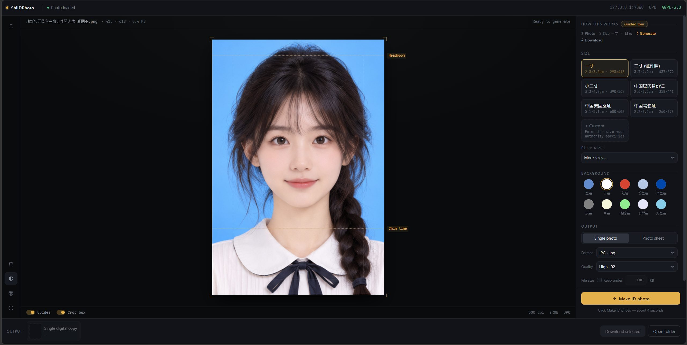
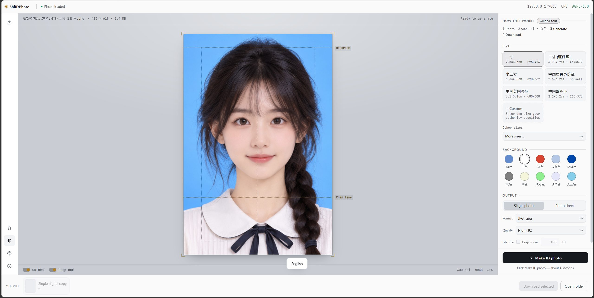
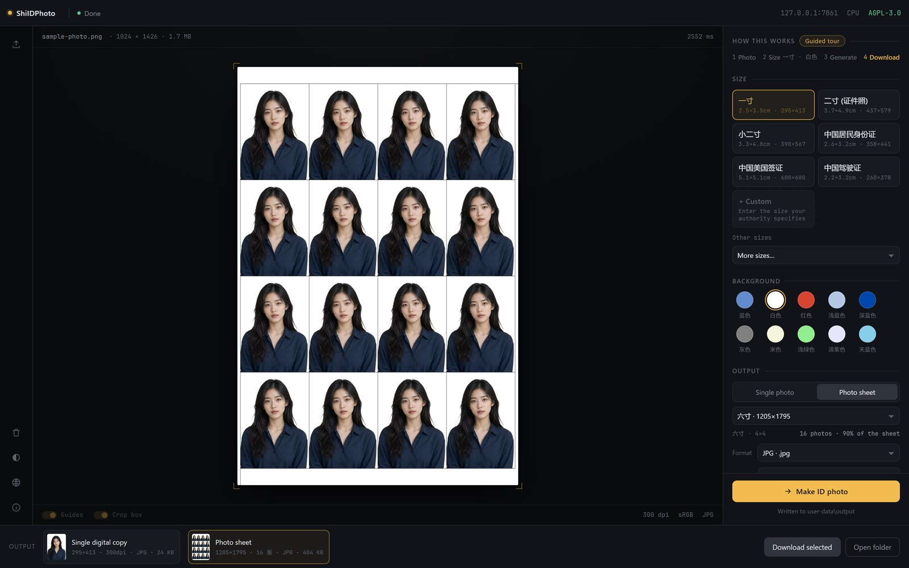
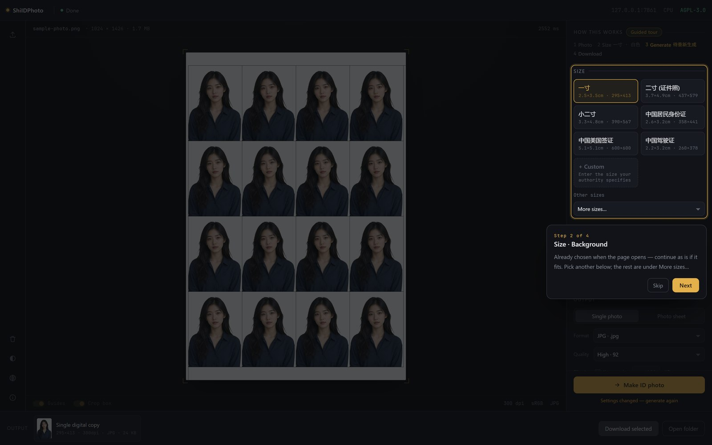
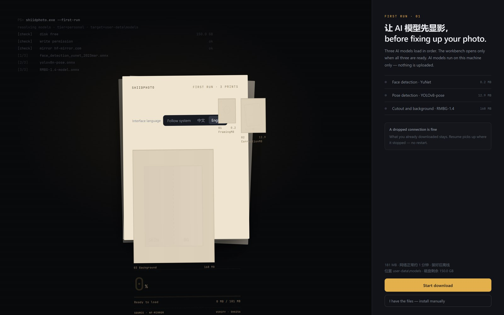
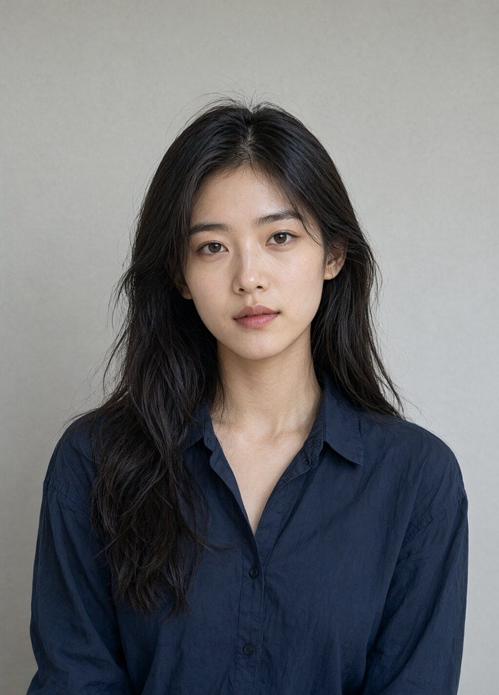
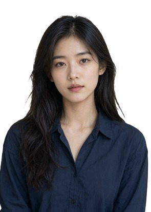
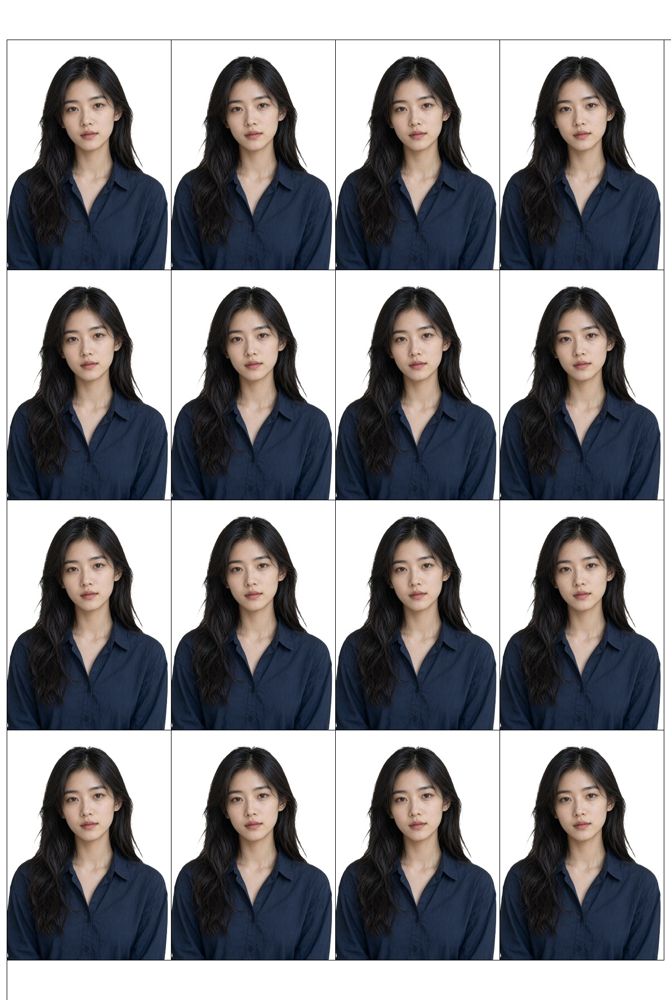

<p align="center"></p>

<h1 align="center">ShiIDPhoto</h1>

<p align="center"><em>Drop a photo, get an ID photo.</em></p>

<p align="center"><strong>English</strong> · <a href="./README.zh.md">简体中文</a></p>

<p align="center">     </p>

<p align="center"></p>

---

An ID photo made entirely on your own machine: unzip the folder, double-click one file,
drag in a photo, and take out a digital copy or a print-ready sheet. No Python to install,
no environment to configure, no upload. Chinese or English interface, dark or light.

The image core reuses [aoguai/LiYing](https://github.com/aoguai/LiYing); this project adds
the launcher, the local UI, the presets, the model-licence gates and the build pipeline.

> **Availability.** The interface language and the light appearance are on `master` and ship in
> the next release; the archive currently hanging on Releases (v0.8.0) has the dark interface in
> Chinese only. Everything else below works in v0.8.0.

## What it does

- **Drop a photo and go.** Drag it onto the canvas, or click the dashed box, or press
  `Ctrl+O`. Size and background are already chosen for you — one inch, white — so pressing
  *Make ID photo* (or `Ctrl+Enter`) is the whole workflow.
- **32 built-in sizes, 10 background colours, 5 print sheets.** The six you actually need are
  laid out as buttons (一寸, 二寸, 小二寸, 居民身份证, 美国签证, 驾驶证); the rest sit under
  *More sizes*, which does list their English names (`One Inch`, `White`). Units stay
  millimetres in both languages — there is no inch equivalent for `一寸`, and inventing one would
  imply a standard that does not exist.
- **Two languages, one click apart.** The left rail has a language button that cycles
  *Follow system → 中文 → English*, and the first-run screen has the same three choices spelled
  out. It switches immediately — no restart, no reload, and a photo already on the canvas stays
  there. Panel headings, buttons, reference-line tags, the guided tour, backend messages and the
  launch console all go English. What is still Chinese in English mode, as measured: the six size
  cards and the ten colour names (the *More sizes* dropdown shows the English ones). What stays
  Chinese on purpose: exported file names — they are the link between a file and the size it was
  made at. The default is *Follow system*: on startup the service reads the Windows UI language
  and picks Chinese for `zh*`, English for anything else.
- **Dark or light.** A toggle on the left rail (half-filled circle, the usual contrast symbol),
  remembered across runs. Dark is the default — this is a darkroom-and-photo-paper product;
  light is ink-on-neutral-grey, which makes a white ID photo's edge easier to judge. It does not
  follow the OS: two states, one deliberate gesture. `?theme=light` in the address bar overrides
  just that opening without writing anything back.
- **Custom sizes.** Enter pixels, or millimetres plus DPI, and generate straight away — or save
  the size for later (up to 20 saved). Sizes required by your institution usually live here.
- **Two outputs.** *Single* gives you one digital copy, which is what an online form wants.
  *Print sheet* also lays the photo out on a photo paper size: one inch on a six-inch sheet
  becomes 4×4 = 16 copies at about 90% of the sheet used. Sheet size and rows/columns are
  computed from the size you picked, so switching modes does not ask you to re-pick anything.
- **Composition rules you can see.** The canvas draws the headroom line and the chin line, and
  tells you when the shot is risky — the most common case being no face detected, or hair
  already touching the top edge so there is no room to add the white margin.
- **It remembers what you chose.** Size, background, output mode, sheet, custom size,
  format/quality/size-cap, interface language and appearance are stored in
  `user-data\prefs.json` inside the folder — not in the browser. Refresh, close and reopen, or
  open it from a different browser: still there. When a remembered choice has gone stale, the
  screen says which one and why it fell back.
- **Output control.** JPG / JPEG / PNG, four quality levels (default: high, 92), and an optional
  file-size cap for the forms that demand "under 100 KB".
- **A first-run wizard.** The downloadable package ships without AI model weights, so the page
  lists the three missing ones and their sizes and downloads them — resumable, with
  pause/continue, and a manual-install path if you already have the `.onnx` files. No command
  line at any point.
- **A guided tour.** Four steps, one control lit at a time, the rest dimmed; `Esc`, clicking
  outside, or *Skip* gets you out. It does not track whether you have seen it — open it again
  whenever.
- **Portable.** Unzip and run. No registry writes, no administrator rights, no installed
  service, and nothing left behind when you delete the folder.
- **Local.** The service binds `127.0.0.1` only. Your photos and your AI model files stay on this
  machine.

## What it is not

- **Not a photo editor.** No blemish removal, no face reshaping, no filters. The automatic
  skin-retouch AI model is disabled because its licence was never verified — a feature that
  cannot be licensed honestly is a feature that should not ship.
- **Not a compliance guarantee.** Composition follows general ID-photo rules. Categories that
  require the face to fill more of the frame — passports, some visas — are out of scope, and no
  tool that crops automatically can promise an authority will accept the result. Check the
  spec of whoever is asking.
- **Not an online service.** No account, no server of the author's, no upload, no telemetry.
  The only outbound requests are the ones listed under *Privacy and boundaries*.
- **Not Windows-only by accident — and not anything else either.** Windows 10/11 x64. The
  launcher, the embedded runtime and the packaging are all built for that.
- **Not a bundle of AI model weights.** The repository contains none, and the published Release is
  the slim package. See *Licences and boundaries*.
- **PNG gets no size cap.** PNG is lossless here; when you need a byte limit, use JPG.
  `pngquant` is not bundled, because its licence does not allow it, so that compression path is
  off.
- **Not everything is translated.** Two interface languages and two appearances — no OS-following
  theme, no third palette. The shipped user guide (`docs/PORTABLE_USER_GUIDE.md`) and the
  release notes stay Chinese, and raw upstream errors are passed through as written rather than
  paraphrased. Screens in English, docs in Chinese: that is the honest state of this version.

## Why this exists

A studio ID photo costs 30–50 CNY and twenty minutes of standing somewhere. Online tools and
phone apps are cheaper, but they ask you to upload a clear, frontal, well-lit photograph of
your face to a server belonging to strangers — and then the free export comes watermarked, or
the high-resolution download sits behind a subscription.

That trade is backwards. An ID photo is the single least uploadable photo you have: it is the
one image designed to be used for identity. So this one runs on your machine. The whole thing
takes a few seconds, the file is yours at full resolution, and there is no account to make.

The honest cost: it is a folder you unzip on Windows, and the first run downloads about
181 MB of AI models before it will show you the main screen. If that is too much ceremony for one
photo, an online tool is the better choice — this one is for the case where you will make
many, or you would rather not send your face anywhere.

## Compared with the usual ways

| | Studio | Online sites and phone apps | ShiIDPhoto |
| --- | --- | --- | --- |
| Where your photo goes | To the shop's PC | To someone's server, usually abroad | Nowhere — `127.0.0.1` only |
| Cost per session | 30–50 CNY | Free tier watermarked, HD behind a paywall | Free (AGPL-3.0) |
| Needs a network | Yes | Yes, every time | Only on first run, for the AI models |
| Re-do in another colour | Ask again | Re-upload | One click, and it remembers you |
| Print sheet | Given on paper | Usually a separate purchase | 16 copies laid out on a six-inch sheet |
| Runs offline afterwards | — | — | Yes |
| Windows folder you can copy to another PC | — | — | Yes |

## Screenshots

These are the English screens; the same four states shot in Chinese sit next door in
[README.zh.md](./README.zh.md). Headings, buttons and hints are English here, while the six size
cards and the colour names stay Chinese in this build — see *What it does* for exactly what is
translated.

### The main screen

After one drag and one click: the one-inch copy on white, `295×413 · 300dpi · JPG · 24 KB`
reported in the bottom-left card, and the headroom and chin lines drawn over the canvas so you
can see what the crop is doing. The right-hand panel is ordered top to bottom the way you work
through it — photo, size, colour, output, generate. The left rail carries the four interface-level
buttons: import, clear, appearance, language, and *About* at the bottom.

<p align="center"></p>

### Dark and light

Same layout, two appearances. The half-filled circle on the left rail switches them, and the
choice is remembered. The photo itself and the photo-paper card never get re-tinted by the theme —
colouring a white ID photo would ruin the preview it is supposed to judge.

| Dark | Light |
|---|---|
|  |  |

### Print sheet mode

Switch *Single photo* to *Photo sheet* and three more controls appear: the sheet size, the layout
(rows × columns, computed for you) and a second thumbnail of the laid-out sheet. Sixteen
one-inch copies on a six-inch sheet, at about 90% of the paper.

<p align="center"></p>

### The guided tour

Press *Guided tour* and the screen dims to one control at a time, with a card that says what
that step is for. The highlighted control stays clickable — you can do the step while it is
being explained.

<p align="center"></p>

### First run

The published package does not contain AI model weights, so the first launch lands here: the three
files, their sizes, and one button. About a minute on a normal connection; it resumes if the
network drops, and *I have the files — install manually* lets you point at `.onnx` files you
already downloaded. The language choice is on this screen too, before anything is fetched.

<p align="center"></p>

### The sample, before and after

| Original | Digital copy | Print sheet |
|---|---|---|
|  |  |  |

The person here is not a real user: the sample portrait is AI-generated, and it is the same
input used in the three screens above.

## Privacy and boundaries

- The service listens on `127.0.0.1` only, on the first free port between 7860 and 7899.
  Nothing is reachable from the network.
- No account, no analytics SDK, no telemetry, no crash reporting. Nothing about you or your
  photos is sent anywhere.
- Two kinds of request do leave the machine, and both are inbound-fetch only:
  the first-run wizard downloading model weights (about 181 MB, from public mirrors),
  and the three QR-code images on the *About* screen (from GitHub, falling back to Gitee).
  Your photos are never part of either.
- What is remembered on disk — size, colour, output mode, sheet, custom size, format/quality/cap,
  **interface language and appearance** — lives in `user-data\prefs.json` in your folder. It is a
  plain text file you can read and delete.
- No registry writes, no administrator rights, no background service. Delete the folder and
  there is nothing left to uninstall.

Full policy: [PRIVACY.md](./PRIVACY.md).

## How to install

1. Download `ShiIDPhoto-Portable-v0.8.0-win-x64-personal-slim.zip` (about 147 MB) from
   [Releases](https://github.com/ShiXiongZhiDao/ShiIDPhoto/releases), together with the
   `.sha256` file next to it.
2. Unzip it into a folder **you intend to keep** — for example `D:\IDPhoto`. Do not run it from
   inside the archive preview window; AI models and outputs are written next to the folder.
3. Double-click `Launch-ShiIDPhoto.bat`. A black console window appears, the local service starts,
   and your browser opens the page on its own.
4. On first run the page lists the three missing AI models. Click *Start download* and wait about
   a minute. It goes to the main screen by itself — no restart.
5. Drag a photo in.

Three things worth knowing before the first run:

- **Closing the black window stops the service.** That console *is* the app; minimise it, do
  not close it. If the page ever stops responding, read that window before you do anything else.
- **Windows SmartScreen may warn about an unsigned executable.** It is a launcher script and an
  embedded Python runtime; choose *More info → Run anyway* if you trust where you downloaded it
  from, and verify the `.sha256` if you do not.
- **The package with AI models bundled is not published.** It contains a background-removal AI model
  whose licence forbids redistribution, so only the slim package ships. See below.

## FAQ

**Why does it have to download AI models at all?**
Because the licences of the AI models used do not all permit redistributing them. Shipping the
weights would be a licence violation, so the package ships the code and the page fetches the
weights from the upstream mirrors on first run. Downloading them is not a licence grant —
check the model licences in [`licenses/THIRD_PARTY_NOTICES.md`](licenses/THIRD_PARTY_NOTICES.md)
before using this commercially.

**Can I copy the folder to another machine?**
Yes. Copy the whole folder, AI models and all — they live in `user-data\models`, so the second
machine skips the wizard. Preferences travel with it too, for the same reason.

**What is the black console window?**
The local service, started by the launcher. It prints which port it settled on, whether the
AI models loaded, and any error. Keep it open while you work.

**The port is taken.**
The launcher tries 7860, then walks up to 7899 and takes the first free one, then opens the
browser at that address. Nothing to configure.

**How do I switch the interface to English?**
The language button on the left rail cycles *Follow system → 中文 → English*; the first-run
screen has the same three choices as buttons. It applies immediately — no restart, no reload,
and a photo already loaded stays loaded. Panel headings, buttons, the reference-line tags, the
guided tour, backend messages and the launch console all switch — that console is what you read
first when something goes wrong. Two gaps in this build, measured rather than intended: the six
size cards and the ten colour names stay Chinese (the *More sizes* dropdown does show `One Inch`,
`White`). What stays Chinese on purpose: exported file names (they encode the size and colour as
the contract knows them), the shipped user guide
([`docs/PORTABLE_USER_GUIDE.md`](docs/PORTABLE_USER_GUIDE.md)), and raw upstream errors, which
are passed through rather than paraphrased.

**Which language do I get by default?**
*Follow system*: on startup the service reads the Windows UI language once — `zh*` gives Chinese,
anything else gives English. It does not re-read it while running; pick a state explicitly if you
want it pinned. The choice is remembered in `user-data\prefs.json` like everything else.

**Does the light appearance follow Windows?**
No — two states, one toggle, no OS detection. Dark is the default because this product is
presented as a darkroom with photo paper; `?theme=light` in the address bar overrides one opening
without writing back, which is the fastest way to compare the two.

**Where do the files go?**
`user-data\output`, and the *Open folder* button at the bottom-right takes you there. The
in-page *Download selected* button goes through the browser instead.

**My output has no white margin above the head.**
That is the input, not the tool. If hair already touches the top edge of the source photo, there
is nothing to expand into. Shoot with about one forehead of space above the crown, or use the
uncropped original — the canvas warns you when this happens.

**Is the automatic skin retouch really off?**
Yes, and it stays off until that AI model's licence is verified. Background replacement, cropping
and print layout are unaffected.

**Can I use this for a passport or a visa?**
Not safely. Those categories want the face to occupy a larger share of the frame than general
ID-photo rules, which this does not implement. The US visa size is in the list, but the size is
not the whole requirement.

**Does it work on Windows 7, or on macOS or Linux?**
No. Windows 10/11 x64 only.

## Build from source

Requires Windows 10/11 x64, Python 3.11+ and Git.

```bat
python scripts\fetch_assets.py --tier personal --pin
python scripts\build_portable.py --tier personal
python scripts\verify_portable.py
```

- `fetch_assets.py` pulls the embedded Python runtime, the upstream source, the AI models and the
  wheels — about 400 MB, from mirrored URLs with a SHA256 check on every file.
- `build_portable.py` assembles the package in `dist\staging` and writes the archive to `dist\`.
- `verify_portable.py` checks structure, presets, model hashes and the licence gate.

To build the slim package without AI models, the same as the published archive:

```bat
python scripts\build_portable.py --tier personal --no-models
```

After a build, double-click `Launch-ShiIDPhoto.bat` to run it. `build-assets\`, `dist\` and
`user-data\` are generated and are not committed.

```
├─ Launch-ShiIDPhoto.bat
├─ launcher.py              # self-check → find a port → start the service → open the browser
├─ portable_checks.py       # shared runtime and build validation
├─ shell/                   # the UI and the local service
├─ config/                  # product config, model manifest, presets, build assets
├─ scripts/                 # fetch, build, preset injection, verification
├─ docs/                    # user guide
├─ assets/                  # screenshots and samples used by this README
└─ licenses/                # third-party and AI model notices
```

## Licences and boundaries

- The code is AGPL-3.0; full text in [`LICENSE`](LICENSE).
- Upstream [aoguai/LiYing](https://github.com/aoguai/LiYing) is AGPL-3.0. Component licences and
  the licence of every AI model — including whether it may be redistributed at all — are listed in
  [`licenses/THIRD_PARTY_NOTICES.md`](licenses/THIRD_PARTY_NOTICES.md).
- The default `personal` tier lets restricted AI models into a package you keep on your own
  machine, for personal use. The `public` tier is refused by the model-licence gate by design:
  distributing those weights needs permission from their authors, or a replacement
  background-removal AI model.

## Changelog

See [CHANGELOG.md](./CHANGELOG.md). Archives are on
[Releases](https://github.com/ShiXiongZhiDao/ShiIDPhoto/releases).

## ☕ Support the author

If this saved you a trip to the studio, you can buy the author a coffee — it keeps projects like
this alive.

| Alipay | WeChat Pay |
|---|---|
|  |  |

## 📮 Contact

- Website: [shixiongzhidao.cn](https://shixiongzhidao.cn)
- Issues: [GitHub Issues](https://github.com/ShiXiongZhiDao/ShiIDPhoto/issues)
- WeChat channel: **师兄知道** (ShiXiongZhiDao) — the same one shown on the app's *About* screen


