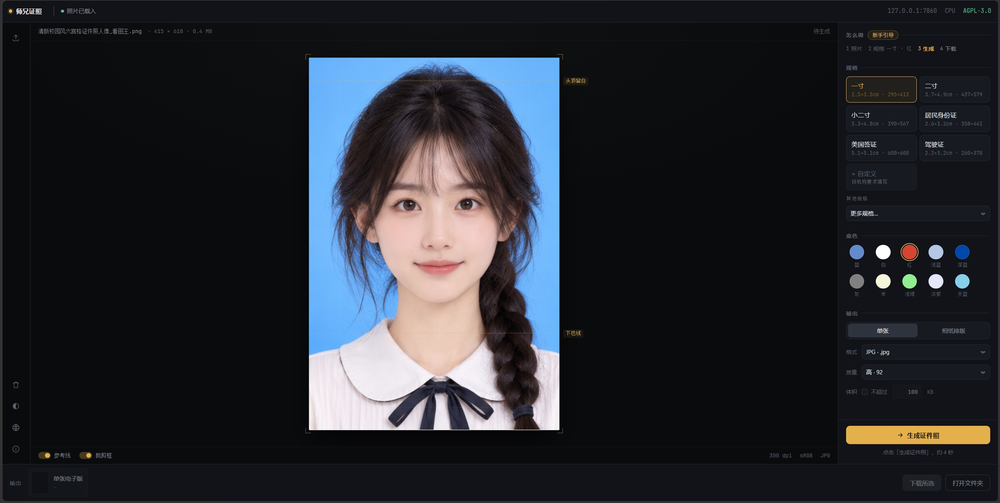
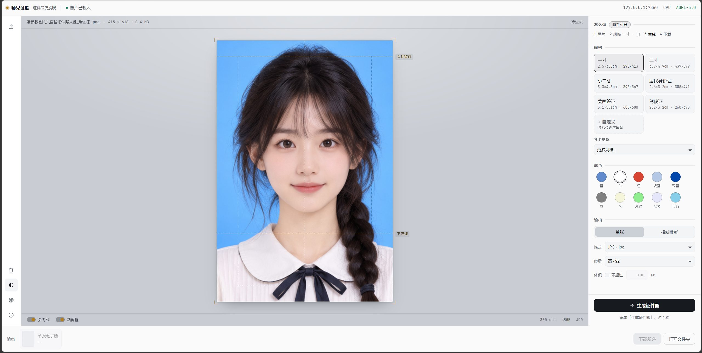
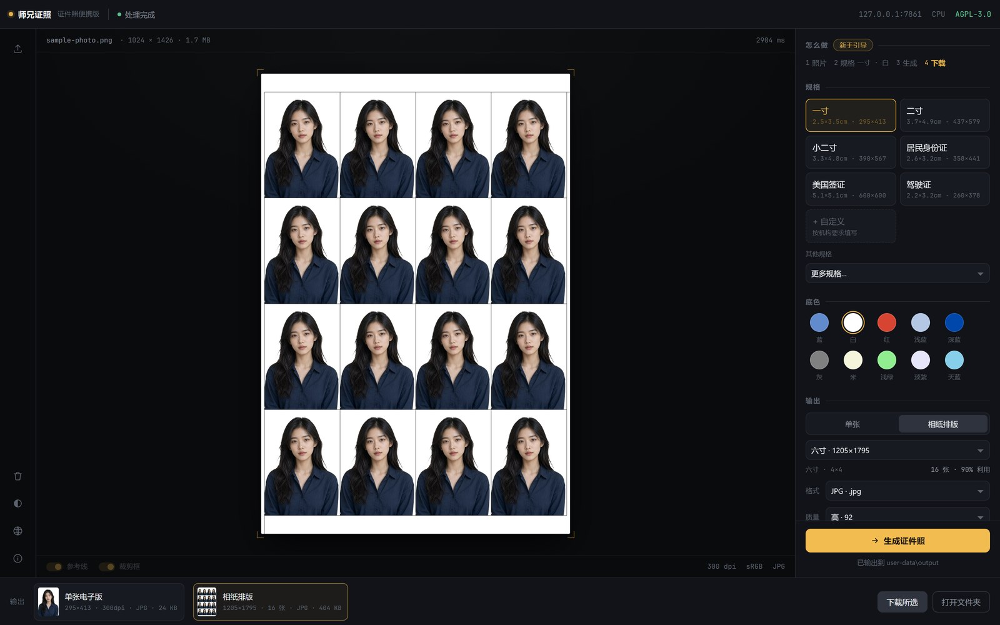
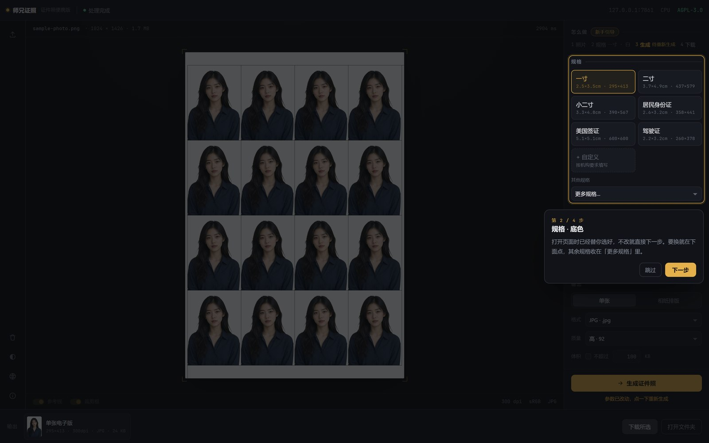
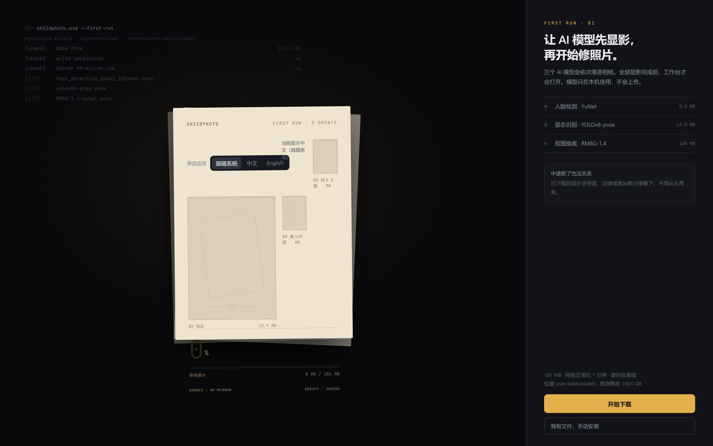
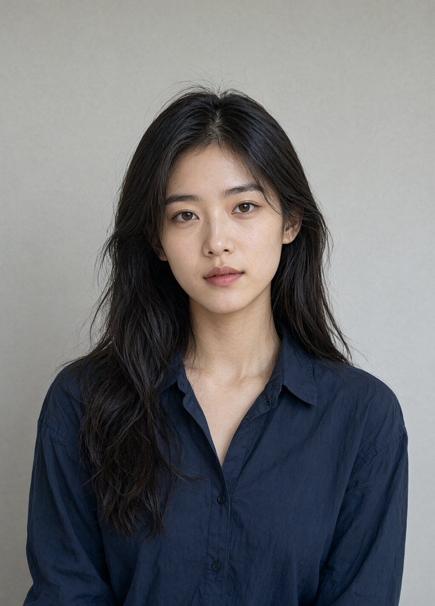
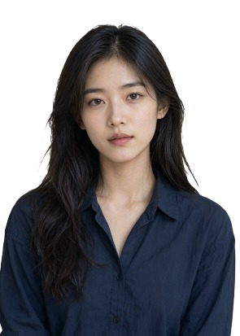
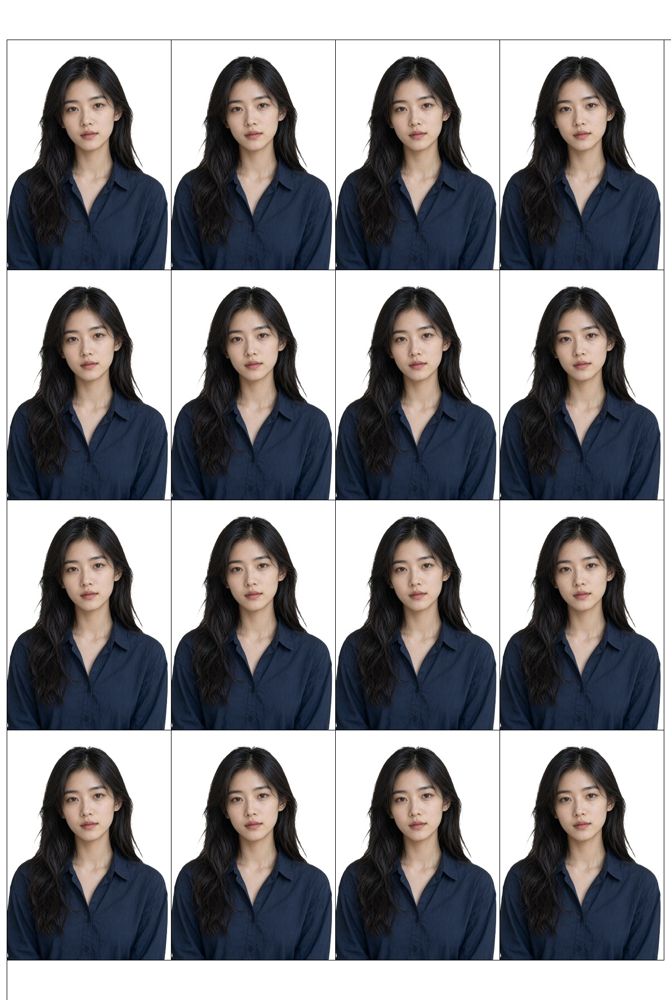

<p align="center"></p>

<h1 align="center">师兄证照 ShiIDPhoto</h1>

<p align="center"><em>拖进一张照片，拿走一张证件照。</em></p>

<p align="center"><a href="./README.md">English</a> · <strong>简体中文</strong></p>

<p align="center">     </p>

<p align="center"></p>

---

一个完全在你自己电脑上完成的证件照工具：解压一个文件夹，双击一个文件，把照片拖进去，
拿走电子版或可送冲印的相纸排版。不用装 Python、不用配环境、不上传。界面中英可切，外观深浅两档。

图像内核复用 [aoguai/LiYing](https://github.com/aoguai/LiYing)，本项目提供启动器、自研前端、
预设、模型许可门禁与构建管线。

> **能拿到哪一版**：Releases 上现在挂的是 v0.9.0——界面语言切换、浅色外观、项目图标与两份入口
> 脚本名都在这一版里。英文态故意保留中文的部分列在「它能做什么」。

## 它能做什么

- **拖进去就能用。** 拖到画布上、点画布里的虚线框、或者 `Ctrl+O`。规格和底色已经替你选好
  （一寸 · 白底），所以点「生成证件照」（或 `Ctrl+Enter`）就是全流程。
- **32 种内置规格、10 种底色、5 种相纸。** 真正常用的六种直接列成按钮（一寸、二寸、小二寸、
  居民身份证、美国签证、驾驶证），其余收在「更多规格」里。单位两种语言都写毫米——`一寸`
  没有对应的 inch 标准名，硬换算反而会让人以为存在某个标准尺寸。
- **界面中英两语，点一下就换。** 左侧栏那颗语言按钮按 `跟随系统 → 中文 → English` 轮换，
  首次使用那一屏上同样给这三颗明确的选项。切换即时生效：不重启、不刷新，画布上已经放好的
  照片还在。面板小标题、按钮、参考线标签、新手引导、后端提示与启动控制台都会翻成英文；
  六张规格卡与十个底色名也走英文目录（`One Inch`、`White`）——v0.9.0 英文态实测全翻。
  导出文件名故意不跟着翻：那串名字是"这张图是哪个规格"的凭据。
  默认「跟随系统」——启动时读一次 Windows 界面语言，`zh` 开头给中文，其余给英文。
- **深浅两档。** 左侧栏一颗半填圆图标（对比度的通用符号），点一下整页换色，重启后还是你上次
  选的那档。默认深色——这产品的气质是暗房加相纸；浅色是「墨黑操作层 + 中性灰画布」，
  白底证件照的边缘在灰画布上更好判色。**不跟随系统**：就两档，靠你明确点一下。
  地址栏 `?theme=light` 只把这一次打开摊成浅色，不写进记住的选择。
- **自定义尺寸。** 填像素，或者填毫米 + DPI，可以直接生成，也可以存下来常用（最多存 20 条）。
  你单位或机构指定的规格通常在这里。
- **两种产出。** 「单张」出一张电子版，这是网上填表要的；「相纸排版」额外把照片铺到相纸上：
  一寸铺满六寸是 4×4 共 16 张，纸面利用率约 90%。相纸尺寸和行列数按规格自动算好，
  切换模式时不用重选。
- **构图规则看得见。** 画布上画出头顶留白线和下巴线；这张图有风险时它会说——最常见的是一开始
  没检测到人脸，或者头发已经贴到画布上边缘、补不出白边。
- **记住你选过什么。** 规格、底色、输出模式、相纸、自定义尺寸，加上格式/质量/体积上限、
  界面语言、深浅外观，都存在包里的 `user-data\prefs.json`——不是存在浏览器里。刷新、关掉重开、
  换个浏览器打开，都还在。某一项失效时，界面会点名是哪一项、为什么回退。
- **输出可控。** JPG / JPEG / PNG，四档质量（默认「高 · 92」），还能设体积上限——
  对付那种「不超过 100 KB」的表格。
- **首次使用向导。** 下载得到的包里不含 AI 模型权重，所以页面会列出缺的三个和它们的体积，
  点一下就开始下载：支持断点续传、暂停/继续，已经有 `.onnx` 文件的话可以走手动安装。
  全程不用命令行。
- **新手引导。** 四步，一次只点亮当前那个控件，其余压暗；`Esc`、点空白处、点「跳过」都能立刻
  退出。它不记「看过没有」，随时可以再点。
- **便携。** 解压即用。不写注册表、不要求管理员、不装服务，删掉文件夹就什么都不剩。
- **本地。** 服务只监听 `127.0.0.1`。照片和 AI 模型都留在这台机器上。

## 它不是什么

- **不是修图软件。** 没有祛痘、没有脸型调整、没有滤镜。自动美肤功能是关着的——那个 AI 模型的许可
  没核实过，说不清授权的就不能算功能。
- **不承诺合规。** 构图按通用证件照口径。要求「脸占更大」的那一类（护照、部分签证）不在范围内；
  任何自动裁切的工具都没法替审核方承诺收不收。以对方给的规格为准。
- **不是在线服务。** 没有账号、没有作者的服务器、不上传、不遥测。真正会出本机的请求只有
  「隐私与边界」那一节列出的两类。
- **不是跨平台。** 只有 Windows 10/11 x64。启动器、嵌入式运行时、打包管线全是为这一档做的。
- **不是 AI 模型权重的合集。** 仓库里一个权重都没有，公开下载的发行包是瘦包。见「许可与边界」。
- **PNG 不提供体积上限。** 这里 PNG 是无损的；要控体积请用 JPG。`pngquant` 因许可证不随包，
  那条压缩路径是关闭状态。
- **不是所有东西都翻。** 界面两种语言、外观两种档，没有第三套配色，也不跟随系统的深浅。
  随包的《使用说明》（`docs/PORTABLE_USER_GUIDE.md`）和更新日志仍是中文；上游抛出来的技术错误
  在英文态直接透传原文，不改写——翻歪了比不翻更难查。

## 为什么做这个

去照相馆拍一张证件照，三十到五十块，站着等二十分钟。在线网站和手机 App 便宜些，
但它们要你做的事是：把一张正面、清晰、光线均匀的自己的脸，传到陌生人的服务器上——
然后免费导出带水印，高清原图再收一次会员。

这笔交易是反的。证件照恰恰是你最不该上传的那张照片：它天生就是用来做身份识别的。
所以这版在你自己机器上跑，几秒钟出片，成片归你，也没有账号要注册。

代价说清楚：它是一个要在 Windows 上解压的文件夹，而且首次运行必须先下约 181 MB 的 AI 模型，
才进得了主界面。如果你只是应急要一张，在线工具更省事；这版是给「要做很多张」或者
「不想把脸送到别处去」的人用的。

## 和常见做法比一比

| | 照相馆 | 在线网站 / 手机 App | 师兄证照 |
| --- | --- | --- | --- |
| 你的照片去了哪 | 到店里的电脑 | 到某个人的服务器，常在境外 | 哪儿也不去，只走 `127.0.0.1` |
| 一次多少钱 | 30–50 元 | 免费档带水印，高清要付费 | 免费（AGPL-3.0） |
| 要不要联网 | 要 | 每次都要 | 只有首次下 AI 模型要 |
| 换个底色重来 | 再要求一次 | 再传一次 | 点一下，而且它记得 |
| 相纸排版 | 给你洗好的纸 | 通常另收费 | 六寸相纸上排 16 张 |
| 装好之后离线能用 | — | — | 能 |
| 文件夹拷到另一台电脑 | — | — | 能 |

## 界面长什么样

下面这些是中文态的界面；英文态的同四屏在 [README.md](./README.md) 里，布局一模一样。
英文态翻的是小标题、按钮、提示，规格卡与底色名也一起翻（见「它能做什么」）。

### 主界面

拖一次、点一次之后：白底一寸，左下角那张卡写着 `295×413 · 300dpi · JPG · 24 KB`，
画布上压着头顶留白线和下巴线，裁切在做什么一眼看得见。右边面板从上到下的顺序就是你
操作的顺序——照片、规格、底色、输出、生成。左边栏那几颗是界面级开关：导入、清空、
深浅外观、界面语言，最下面一颗「关于」。

<p align="center"></p>

### 深色与浅色

同一套布局两档配色。左边栏那颗半填圆图标切换，选完记住。照片本体和相纸那几张卡的颜色
**不跟主题变**——给白底证件照染色会毁掉它本来要判的东西，相纸刻度改了也读不出来。

| 深色（默认） | 浅色 |
|---|---|
|  |  |

### 相纸排版

把「单张」切到「相纸排版」，多出来三处：相纸尺寸、排版行列（按规格算好的）、
以及底部那张相纸缩略图。六寸相纸上 16 张一寸，纸面利用率约 90%。

<p align="center"></p>

### 新手引导

点「新手引导」，屏幕压暗、一次只点亮当前那个控件，旁边一张卡片说明这一步是干什么的。
被点亮的控件照常能点——解释到这一步你就可以直接做这一步。

<p align="center"></p>

### 首次使用

公开下载的包不含 AI 模型权重，所以第一次打开会停在这里：三个文件、各自体积、一个按钮。
网络正常约一分钟；断线会从断点接着下，已经有文件的话点「我有文件，手动安装」。
这一屏上也有那三颗语言选项——想换英文，在下载之前就换。

<p align="center"></p>

### 同一张样张的前后

| 原图 | 电子版 | 相纸排版 |
|---|---|---|
|  |  |  |

这里的人不是真实用户：样张是 AI 生成的合成人像，上面那三张界面图用的也是它。

## 隐私与边界

- 服务只监听 `127.0.0.1`，端口在 7860–7899 里取第一个空的。网络侧谁都够不着它。
- 没有账号、没有统计 SDK、没有遥测、没有崩溃上报。关于你和你的照片，一个字节都不发出去。
- 确实有请求会出本机，两类，而且都只是「进来」不「出去」：首次向导下载模型权重
  （约 181 MB，来自公开镜像），以及「关于」页那三张二维码图（GitHub，失败退到 Gitee）。
  你的照片不在其中任何一次请求里。
- 记在硬盘上的那些选择——规格、底色、输出模式、相纸、自定义尺寸、格式/质量/体积上限、
  **界面语言、深浅外观**——就是包里 `user-data\prefs.json` 这一个文本文件，能读、能删。
- 不写注册表、不要求管理员、不装后台服务。删掉文件夹就没有需要卸载的东西。

完整政策见 [PRIVACY.md](./PRIVACY.md)。

## 怎么装

1. 到 [Releases](https://github.com/ShiXiongZhiDao/ShiIDPhoto/releases) 下载
   `ShiIDPhoto-Portable-v0.9.0-win-x64-personal-slim.zip`（约 147 MB），以及旁边那个 `.sha256`。
2. 解压到一个**你打算长期留着**的文件夹，例如 `D:\证件照`。不要在压缩包的预览窗口里直接双击——
   模型和成片都要写到这个文件夹旁边。
3. 双击 `双击启动师兄证照.bat`。会出现一个黑色命令行窗口，本地服务在里面启动，浏览器自动打开页面。
4. 首次使用会列出缺的三个模型，点「开始下载」，约一分钟。装完自动进主界面，不用重开。
   这一屏上也能先把界面语言定成 English 或中文。
5. 把照片拖进去。

第一次运行之前，三件事先知道：

- **关掉那个黑窗口就是关掉服务。** 那个命令行窗口就是程序本身，最小化可以，别关。
  页面卡住时先看那个窗口里写了什么，再决定做什么。
- **Windows SmartScreen 可能拦一个没有签名的可执行文件。** 那是启动脚本和一个嵌入式 Python
  运行时。确认下载来源可信后点「更多信息 → 仍要运行」，不放心就核一下 `.sha256`。
- **带模型权重的完整包不公开提供。** 里面那个抠图模型的许可证禁止再分发，所以只发瘦包。见下一节。

## 常见问题

**怎么把界面切成英文？**
左侧栏那颗语言按钮按 `跟随系统 → 中文 → English` 轮换，首次使用那一屏上也有这三颗选项。
切下去立刻生效：不重启、不刷新，画布上的照片还在原处。翻过去的是面板小标题、按钮、
参考线标签、新手引导、后端提示和启动控制台，六张规格卡与十个底色名也在这一层里（`One Inch`、
`White`，取自上游的英文目录，与中文表逐行对齐）。有些东西是故意不翻的：
导出文件名（那串名字是"这张图是哪个规格"的凭据）、随包的《使用说明》
（[`docs/PORTABLE_USER_GUIDE.md`](docs/PORTABLE_USER_GUIDE.md)），以及上游抛出来的技术错误——
那种句子照原文透传，翻歪了比不翻更难查。

**默认给我哪种语言？**
「跟随系统」：启动时服务端读一次 Windows 界面语言，`zh` 开头出中文，其余出英文。
运行中不再跟系统变；要钉死就显式选中文或 English。这个选择和其他选择一样记在
`user-data\prefs.json` 里。

**浅色外观会跟着 Windows 的深浅设置吗？**
不会。就两档，靠你明确点一下那颗开关。想快速对比，地址栏加 `?theme=light`——
只把这一次打开摊成浅色，不写进记住的选择。

**为什么一定要下载 AI 模型？**
因为所用模型的许可并不都允许再分发。把权重打进包就是违反许可，所以包里只有代码，
权重由页面在首次运行时从上游镜像取。**下载到 ≠ 拿到授权**——商用之前请先读
[`licenses/THIRD_PARTY_NOTICES.md`](licenses/THIRD_PARTY_NOTICES.md) 里逐个模型的许可。

**能把文件夹拷到另一台电脑吗？**
能。整个文件夹拷过去，模型也在里面（`user-data\models`），第二台机器就不会再走首次向导。
你记住的那些选择也跟着文件夹走，原因相同。

**那个黑色命令行窗口是什么？**
本地服务本体，由启动器拉起。它打印最终用了哪个端口、模型加载好了没有、以及任何报错。
用的时候保持它开着。切到英文态时这扇控制台也是英文——启动失败时你最先看到的就是它。

**端口被占了怎么办？**
启动器从 7860 往上试到 7899，取第一个空端口，并用那个地址打开浏览器。不用你配置。

**成片存在哪？**
`user-data\output`，右下角那颗「打开文件夹」直接过去。页面里的「下载所选」走浏览器下载。

**出来的照片头顶上没有白边。**
这是原图的问题，不是工具的。原图里头发已经贴到画布上边缘，程序补不出白边，
出来的一寸照头顶会紧贴边（只有 1mm 左右），拿去提交容易被退回。拍的时候头顶上方留出约
一个额头的空，或者干脆用没裁过的原图。画布上出现那条黄色提示说的就是这件事。

**自动美肤真的关着？**
是，而且在那个 AI 模型许可核实之前一直关着。换底色、裁切、排版不受影响。

**能拿来办护照或签证吗？**
不建议。那一类要求脸占画面更大，本工具按通用证件照口径实现，没有做这个档位。
列表里有「美国签证」的尺寸，但尺寸不等于全部要求。

**Windows 7 能用吗？macOS、Linux 呢？**
都不能。只有 Windows 10/11 x64。

## 从源码构建

需要 Windows 10/11 x64、Python 3.11+ 与 Git。

```bat
python scripts\fetch_assets.py --tier personal --pin
python scripts\build_portable.py --tier personal
python scripts\verify_portable.py
```

- `fetch_assets.py` 下载嵌入式 Python 运行时、上游源码、AI 模型与 wheel，约 400 MB；
  每个文件都有镜像地址和 SHA256 校验。
- `build_portable.py` 在 `dist\staging` 组装，产物写到 `dist\`。
- `verify_portable.py` 检查结构、预设、AI 模型哈希与许可门禁。

不带 AI 模型的瘦包（和公开提供的发行包同一档）：

```bat
python scripts\build_portable.py --tier personal --no-models
```

构建后双击 `双击启动师兄证照.bat` 即可运行。`build-assets\`、`dist\` 与 `user-data\` 都是生成物，
不进版本库。

```
├─ 双击启动师兄证照.bat
├─ launcher.py              # 自检 → 找端口 → 拉起服务 → 开浏览器
├─ portable_checks.py       # 运行期与构建期共用的校验
├─ shell/                   # 自研前端与本地服务
├─ config/                  # 产品配置、模型清单、预设、构建资产
├─ scripts/                 # 取资产、构建、预设注入、验收
├─ docs/                    # 使用说明
├─ assets/                  # 本文档用的截图与样张
└─ licenses/                # 第三方组件与 AI 模型声明
```

## 许可与边界

- 代码以 AGPL-3.0 发布，全文见 [`LICENSE`](LICENSE)。
- 上游 [aoguai/LiYing](https://github.com/aoguai/LiYing) 是 AGPL-3.0。第三方组件与各 AI 模型权重的
  许可证、再分发状态见 [`licenses/THIRD_PARTY_NOTICES.md`](licenses/THIRD_PARTY_NOTICES.md)。
- 默认的 `personal` 档允许受限的抠图 AI 模型进入本地包，仅限自用。`public` 档会被模型许可门禁拒绝，
  这是设计行为：要公开发行，必须先取得授权或替换抠图 AI 模型。

## 版本变化

见 [CHANGELOG.md](CHANGELOG.md)；发行包在
[Releases](https://github.com/ShiXiongZhiDao/ShiIDPhoto/releases)。

## ☕ 赞助作者

如果这省下了你一趟照相馆，可以请作者喝杯咖啡——这类小工具就靠这个继续做下去。

| 支付宝 | 微信支付 |
|---|---|
|  |  |

## 📮 联系

- 个人主页：[shixiongzhidao.cn](https://shixiongzhidao.cn)
- 问题反馈：[GitHub Issues](https://github.com/ShiXiongZhiDao/ShiIDPhoto/issues)
- 微信公众号：**师兄知道**——软件里「关于」页展示的是同一个


